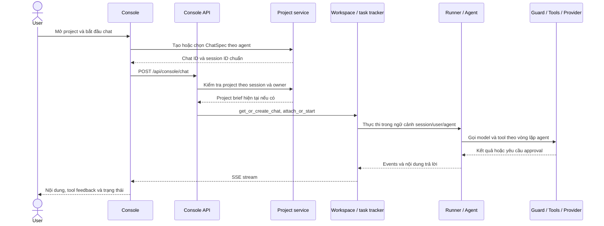
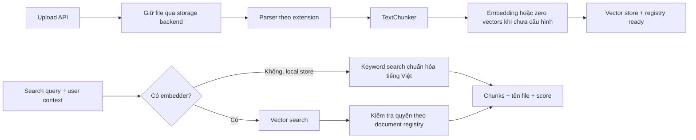
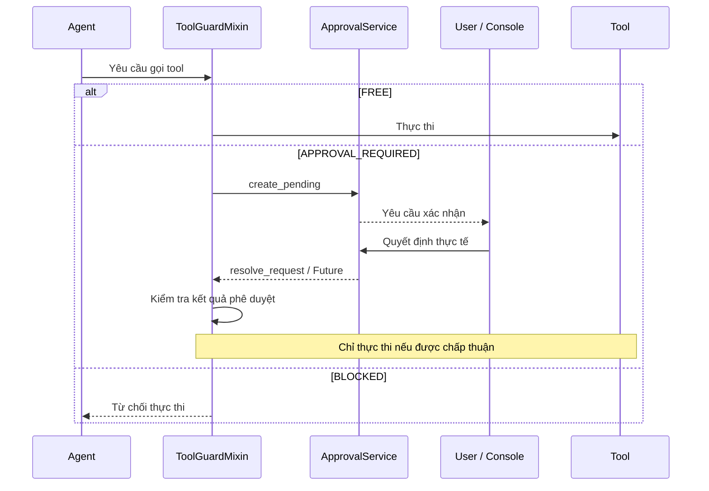

# Kiến trúc SpiderAgents / OpenSpider

Ngày cập nhật: 16/10/2026. Phạm vi: implementation trong working tree hiện tại,
bao gồm Projects, giao diện Spider và sửa pipeline Knowledge Base.
Hướng dẫn vận hành: [Hướng dẫn sử dụng](19-huong-dan-su-dung.md).

## 1. Mục tiêu và ranh giới

SpiderAgents là giao diện của nền tảng kết hợp hội thoại, thực thi tác vụ và
kết nối hạ tầng. Backend đang phát triển nằm trong `src/openspider/`; CLI vẫn
là `openspider`, namespace cấu hình là `OPENSPIDER_*`. Tên distribution trong
`pyproject.toml` hiện vẫn là `qwenpaw`; không suy ra tên package cài đặt từ branding.
`src/qwenpaw/` là baseline legacy đóng băng, không phải nơi thêm tính năng.

| Đã có trong code | Giới hạn / chưa được suy diễn thành khả năng sẵn có |
|---|---|
| Projects theo user, chat theo agent/session, instructions riêng | Project chưa tạo sandbox OS/container hoặc môi trường Python riêng |
| Runner, tool execution, approval, plan/mission và cron | Lịch chạy không đồng nghĩa có cluster worker hoặc đảm bảo SLA |
| MCP và provider abstraction | Không phải mọi API/hạ tầng đều đã có connector |
| Ingestion, chunks, vector stores, quyền tài liệu | Không có OCR tự động trong parser PDF hiện tại |
| SQLite/JSON và các PostgreSQL repository | Cần kiểm tra đường ghi thực tế; một số service vẫn ghi file |
| Theme, màu và animation lưu trong browser | Chưa có đồng bộ appearance đa thiết bị trong luồng này |

## 2. Sơ đồ thành phần

```mermaid
flowchart TB
    User[Người dùng] --> UI[React Console / SpiderAgents]
    UI --> API[FastAPI /api + auth + agent context]
    API --> Projects[Project service / user settings]
    API --> MM[MultiAgentManager]
    Channels[Messaging channels] --> MM
    MM --> WS[Workspace theo agent]
    WS --> Runner[AgentRunner]
    WS --> KB[KnowledgeBaseManager]
    WS --> Cron[CronManager]
    WS --> MCP[MCPClientManager]
    Cron --> Runner
    Runner --> Agent[SpiderAgent / AgentScope]
    Agent --> Providers[ProviderManager / model adapters]
    Agent --> Guard[ToolGuardMixin]
    Guard --> Approval[ApprovalService]
    Guard --> Tools[Built-in tools / skills / MCP tools]
    Tools --> External[Files / processes / external services]
    MCP --> External
    KB --> Files[Document storage]
    KB --> Vector[Local / Chroma / Qdrant / Milvus]
    Runner --> History[Chat and session persistence]
```



Sơ đồ mô tả trách nhiệm logic; không có nghĩa mỗi khối là một service deploy
độc lập. MCP client manager quản lý kết nối; tool invocation của agent vẫn phải
đi qua cơ chế bảo vệ tool hiện hữu.

## 3. Bản đồ code

| Thành phần | Vị trí |
|---|---|
| CLI, điểm khởi động Python | [`cli/`](../src/openspider/cli/), [`__main__.py`](../src/openspider/__main__.py) |
| FastAPI, lifecycle, static console | [`app/_app.py`](../src/openspider/app/_app.py) |
| API routers và chọn agent | [`app/routers/`](../src/openspider/app/routers/), [`app/agent_context.py`](../src/openspider/app/agent_context.py) |
| Workspace và service factories | [`app/workspace/`](../src/openspider/app/workspace/) |
| Chat runner và repositories | [`app/runner/`](../src/openspider/app/runner/) |
| Agent, tools, skills và guard | [`agents/`](../src/openspider/agents/), [`security/`](../src/openspider/security/) |
| Projects | [`app/projects.py`](../src/openspider/app/projects.py), [`routers/projects.py`](../src/openspider/app/routers/projects.py) |
| Models và provider adapters | [`providers/`](../src/openspider/providers/), [`routers/providers.py`](../src/openspider/app/routers/providers.py) |
| MCP, cron và approval | [`app/mcp/`](../src/openspider/app/mcp/), [`app/crons/`](../src/openspider/app/crons/), [`app/approvals/`](../src/openspider/app/approvals/) |
| Knowledge Base | [`knowledge/`](../src/openspider/knowledge/), [`routers/knowledge.py`](../src/openspider/app/routers/knowledge.py) |
| Config và persistence | [`config/`](../src/openspider/config/), [`constant.py`](../src/openspider/constant.py), [`db/`](../src/openspider/db/) |
| Frontend | [`console/src/`](../console/src/), [`console/vite.config.ts`](../console/vite.config.ts) |

## 4. Luồng Chat từ project đến kết quả



`get_agent_for_request` định tuyến vào workspace theo ngữ cảnh agent, trong đó
có header `X-Agent-Id`. `MultiAgentManager` hỗ trợ lazy loading workspace.
Workspace tập hợp runner, channel manager, MCP, cron, chat manager và knowledge
service. Nội dung instructions của project được runner thêm vào environment
context sau khi server kiểm tra quyền và project đang hoạt động.

Task tracker tách vòng chạy khỏi subscriber SSE. Mất kết nối giao diện không
đồng nghĩa hủy tác vụ; endpoint `/api/console/chat/stop` dùng để yêu cầu dừng.
Reconnect dùng trường `reconnect=true` theo contract console hiện tại.

Frontend phải chuyển đúng ChatSpec khi đi Projects → Chat. Session adapter tránh
để response danh sách/history cũ ghi đè cuộc hội thoại vừa chọn. PageTransition
render children hiện tại, không giữ bản route cũ để chờ animation.

## 5. Model và provider

`ProviderManager` quản lý cấu hình provider, model catalog và default model.
Provider adapter cung cấp kiểm tra kết nối, khám phá model khi được hỗ trợ,
kiểm tra một model và tạo chat model instance. `OpenAIProvider` phục vụ các
endpoint tương thích Chat Completions; các protocol khác có adapter riêng.

Thứ tự chọn model trong API active models:

1. `scope=agent`: chỉ đọc cấu hình riêng của agent; có thể trả `null`.
2. `scope=global`: đọc default model của ProviderManager.
3. `scope=effective`: ưu tiên model riêng của agent, fallback về global.

Trang Models lưu Default LLM với `scope=global`. Model selector trong Chat lưu
cấu hình theo agent. Test model hiện là yêu cầu nhỏ; không thay thế kiểm thử
streaming, tool calling hoặc multimodal trong toàn bộ vòng chạy.
Chi tiết: [Provider pattern](03-providers.md).

## 6. Projects, user và giới hạn cô lập

Projects là lớp tổ chức công việc bên trên runner hiện hữu. Mỗi project có
brief, objective, instructions, trạng thái archive và tham chiếu MCP. Chat của
project có metadata/session riêng; server kiểm tra quyền trên đường vào chat.

Project collection được lưu qua contract `get_setting` / `set_setting` của
`app.state.user_data_store`, key `spideragents.projects.v1`, theo từng user.
Version kiểm soát stale update; xung đột trả HTTP 409. Lock trong application
bảo vệ read/modify/write cho mô hình một process hiện tại. Deploy nhiều worker
cần cơ chế compare-and-swap/transaction ở database trước khi coi cập nhật project
là an toàn giữa các process.

User identity lấy từ auth context, không tin trường owner trong request body.
Ở chế độ tắt auth, project service dùng identity local `default`. Project không
phải boundary cô lập process hoặc filesystem; việc phân quyền ứng dụng không
tương đương sandbox cho mã Python/shell của từng người dùng.

Tham chiếu MCP trong project chỉ lưu liên kết đến cấu hình user sở hữu, không
chứa credentials và chưa phải allowlist thực thi tool. Chi tiết các giới hạn và
API: [Projects](17-projects.md).

## 7. Knowledge Base: ingest, recovery và retrieval



`KnowledgeBaseManager` quản lý metadata và lifecycle; `parsers.py` chọn parser;
`TextChunker` chia văn bản. Parse/chunk trong luồng index được offload qua
`asyncio.to_thread`. Storage backend gồm local và MinIO; vector store có các
implementation local, Chroma, Qdrant, Milvus, cần dependency/cấu hình tương ứng.

Sau khi lưu file, index phải tạo được chunks và ghi vector store mới đặt `ready`.
Khi lỗi, document giữ `error_message`. Re-index dùng lại document hiện hữu,
retrieve file qua storage backend, giữ ID/ACL và thay chunks; kết quả tổng hợp
đếm thành công/thất bại thực tế. Non-admin có identity chỉ re-index tài liệu
mình sở hữu, không sửa tài liệu chỉ được chia sẻ để đọc.

Khi chưa cấu hình embedder, local retrieval dùng điểm phủ từ khóa truy vấn trong
chunk; chuẩn hóa Unicode, chữ hoa/thường và dấu tiếng Việt. Tập document hợp lệ
được lọc theo quyền, KB và trạng thái `ready` trước khi lấy top-k. Cơ chế này
không có khả năng hiểu đồng nghĩa như semantic embeddings và không phải fallback
cho tất cả remote vector stores.

**Registry đang dùng file**: constructor đặt đường dẫn
`<workspace>/knowledge_base/documents.json`; `_load_registry` / `_save_registry`
đọc/ghi file này trực tiếp. Không nên khẳng định flag PostgreSQL đã chuyển toàn
bộ KB sang database chỉ vì tồn tại table/repository dành cho knowledge documents.

## 8. MCP, jobs và approval

MCP cấu hình transport `stdio`, `streamable_http`, `sse`. Manager quản lý client
và kết nối; agent sử dụng tool được đăng ký. Dịch vụ ngoài phải có MCP server hoặc
extension/tool tương ứng; platform chưa tự biến một URL REST thành connector.

CronManager quản lý lịch và thực thi theo workspace. API `/api/cron/jobs` cung
cấp CRUD và thao tác pause/resume/run theo implementation. Plan/mission cung cấp
cơ chế lập kế hoạch trong runner; cần phân biệt trạng thái plan với bằng chứng
công việc thực tế đã thành công. Xem [Plan và Mission](09-plan-mission.md).

Luồng approval:



Không bypass guard hoặc tự coi timeout/câu trả lời LLM là approval. Khi mở rộng
tool hạ tầng, kiểm tra quyền user/agent, credentials và kết quả từ hệ thống đích.
Chi tiết: [Security](10-security.md), [Harness](16-harness-engineering.md).

## 9. Persistence và cấu hình vận hành

| Dữ liệu | Đường lưu / abstraction hiện tại |
|---|---|
| Projects và user settings | UserDataStore SQLite hoặc PgUserDataStore, theo cấu hình app |
| Danh sách chat | ChatManager; service factory chọn JsonChatRepository hoặc PgChatRepository |
| Session history | Session persistence của runner; xem implementation/repositories trước khi di chuyển dữ liệu |
| Knowledge registry | `knowledge_base/documents.json` trong workspace |
| File tài liệu | Storage backend local hoặc MinIO |
| Chunks/vectors | Backend local JSON, Chroma, Qdrant hoặc Milvus đã cấu hình |
| Provider, agent và auth config | Các config/store tương ứng; lưu cùng bộ working/secret directory |
| Appearance | Local storage của trình duyệt |

`OPENSPIDER_WORKING_DIR` và `OPENSPIDER_SECRET_DIR` phải được chọn trước khi app
import cấu hình. `.env` ở root repository được load khi đọc constants; biến
terminal đã đặt có ưu tiên hơn. `OPENSPIDER_DATABASE_ENABLED=false` dùng đường
SQLite/JSON; bật PostgreSQL cần database sẵn sàng và migration riêng. Tham khảo
[`migrate_to_postgres.py`](../scripts/migrate_to_postgres.py) và
[`docker-compose.postgres.yaml`](../docker-compose.postgres.yaml); không suy ra
mọi file đã được di chuyển chỉ từ việc bật flag.

Bản hiện tại dùng `logs/projects-preview` cho dữ liệu local trong quá trình phát
triển. Đây là dữ liệu cần backup, không phải chỉ log có thể xóa. Chưa kiểm chứng
live PostgreSQL cho toàn bộ thay đổi Projects/KB trong đợt cập nhật này.

## 10. Frontend, deployment và kiểm chứng

Frontend dùng React, TypeScript, Vite, React Router và các component Ant Design /
AgentScope. Trang Projects cùng shell Spider nằm trong `console/src/`; theme
palette, spider SVG/CSS và transition là code frontend. Appearance lưu trong
browser, animation tôn trọng `prefers-reduced-motion`.

Dev: Vite 5173 proxy `/api` tới backend 8000. Bundle: `npm run build` tạo
`console/dist`, backend phục vụ static cùng origin. Có thể chỉ định bundle bằng
`OPENSPIDER_CONSOLE_STATIC_DIR`. API trong luồng console này dùng prefix `/api`,
không mặc định `/api/v1`. Ví dụ:

| Nhóm | Endpoint tiêu biểu |
|---|---|
| Chat | `POST /api/console/chat`, `POST /api/console/chat/stop` |
| Model | `GET /api/models`, `GET/PUT /api/models/active` |
| Projects | `GET/POST /api/projects`, `POST /api/projects/{id}/chats` |
| Knowledge | `POST /api/knowledge/documents/upload`, `POST /api/knowledge/search`, `POST /api/knowledge/reindex` |
| Jobs | `GET/POST /api/cron/jobs` |

Những kiểm chứng đã thực hiện trong quá trình phát triển, không phải cam kết
coverage toàn hệ thống:

- Projects và điều hướng: kết quả test/UI được ghi ở [17](17-projects.md) và
  [18](18-spider-appearance-and-navigation.md).
- KB: 10 regression tests trong
  [`test_knowledge_indexing.py`](../tests/unit/app/test_knowledge_indexing.py);
  API local đã re-index PDF thực tế thành 36 chunks và tìm được nội dung.
- Phiên chạy local gần nhất: trang Projects/Models render được; API agents và
  KB trả 200; test provider/model hiện chọn thành công. Điều đó chưa kiểm chứng
  toàn bộ chat tool loop hoặc connector hạ tầng.
- Repository-wide lint còn lỗi tồn tại từ trước; không coi kiểm tra riêng các
  phần thay đổi là toàn bộ hệ thống đã qua lint/test.

Lệnh kiểm tra theo phạm vi thay đổi, từ root hoặc `console/` tương ứng:

```powershell
python -m pytest tests/unit/app/test_knowledge_indexing.py -x -q --tb=short
python -m pytest tests/unit/app/test_projects.py -x -q --tb=short
```

```powershell
# Chạy từ console/
npm run lint
npx vitest run src/pages/Chat/sessionApi/projectHandoff.test.ts
npm run build
```

Dùng working/secret directory riêng cho test để không tác động dữ liệu đang dùng.
Không cần build hoặc chạy lại backend khi chỉ chỉnh tài liệu Markdown.
